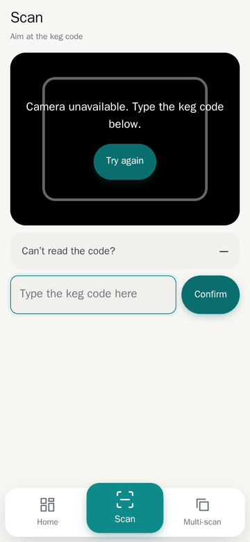
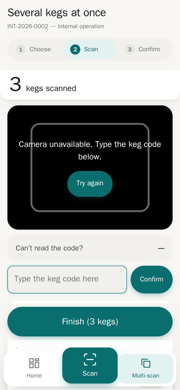
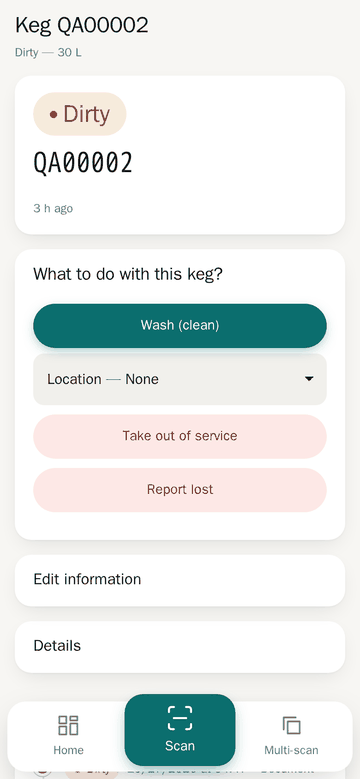
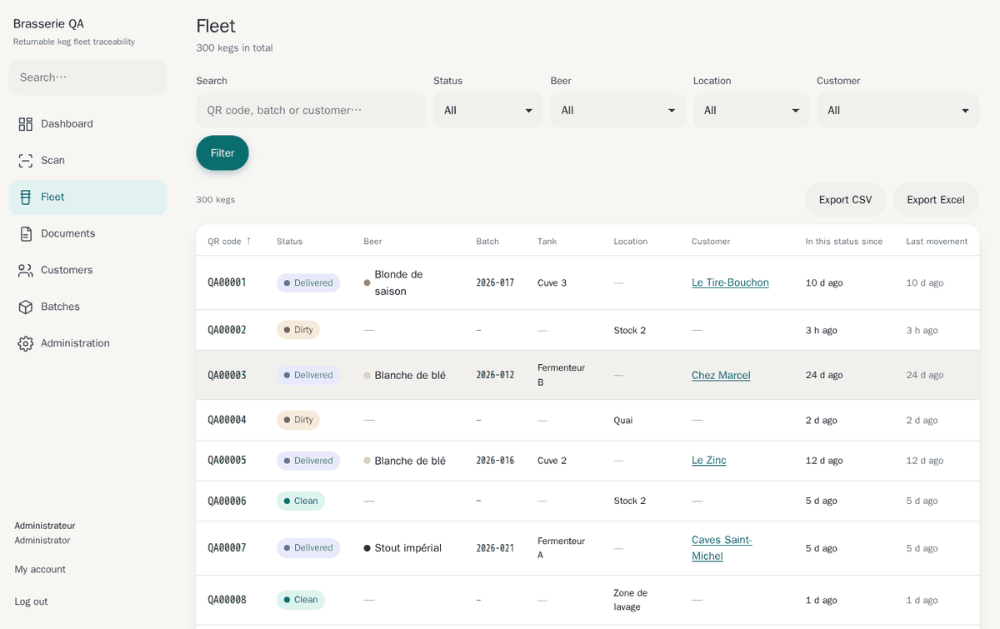
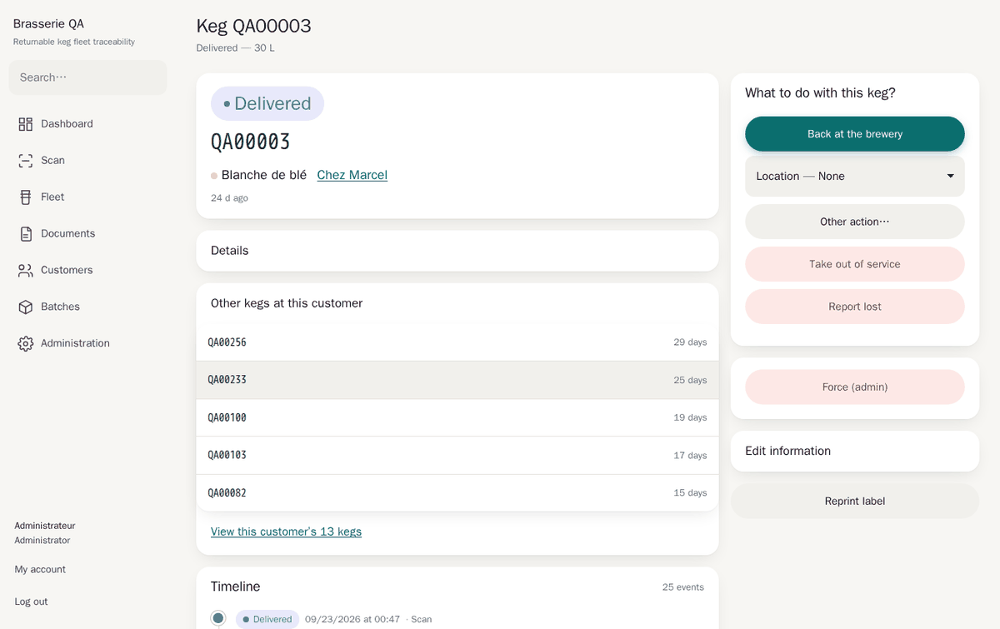
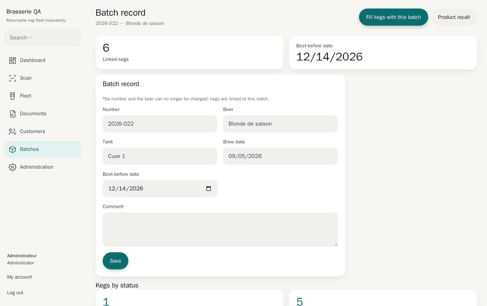
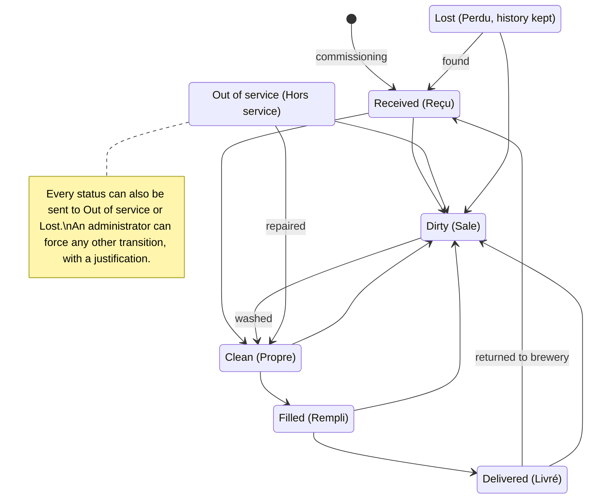
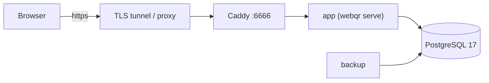
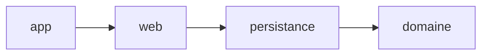

<div align="center">

# Keg Tracking

**QR-code traceability for returnable beer kegs, offered as SaaS to breweries.**

[](https://github.com/Theroxat/WebQr_brasserie/actions/workflows/integration.yml)


<br>

<table>
  <tr>
    <td align="center"><picture><source media="(prefers-color-scheme: dark)" srcset="docs/images/scan-mobile-dark.png"></picture></td>
    <td align="center"><picture><source media="(prefers-color-scheme: dark)" srcset="docs/images/capture-mobile-dark.png"></picture></td>
    <td align="center"><picture><source media="(prefers-color-scheme: dark)" srcset="docs/images/keg-mobile-dark.png"></picture></td>
  </tr>
</table>

<picture>
  <source media="(prefers-color-scheme: dark)" srcset="docs/images/fleet-desktop-dark.png">
  
</picture>

</div>

<details>
<summary><b>Screenshots</b></summary>

<br>

<picture>
  <source media="(prefers-color-scheme: dark)" srcset="docs/images/keg-desktop-dark.png">
  
</picture>

<picture>
  <source media="(prefers-color-scheme: dark)" srcset="docs/images/lot-desktop-dark.png">
  
</picture>

</details>

> The application itself is in French. UI labels are quoted in French with an English gloss in parentheses.

## Contents

[Why](#why) · [Features](#features) · [Diagrams](#diagrams) · [Quick start](#quick-start) · [Configuration](#configuration) · [Operations](#operations-commands) · [Development](#development) · [Architecture](#architecture) · [Tests and CI](#tests-and-ci) · [Documentation](#documentation) · [Out of scope](#out-of-scope-v1) · [License](#license)

---

## Why

Every keg carries a QR label, and every field operation is done by scanning that label with a phone. The **history of operations is the source of truth**, not the keg record. At any moment the application answers:

1. **Where is this keg**, and for how long?
2. **What is in it?** Which beer, which lot, which tank?
3. **How many clean kegs** are available for filling?
4. **Which ones have not come back** after more than N days?
5. **Who received lot 2026-017?** The product recall, in one click.

---

## Features

### In the field (mobile)

| Screen | What it does |
|---|---|
| **Scanner** | Accepts a Bluetooth scanner (seen as a keyboard), the rear camera with torch, or manual entry (collapsed). Each read gives three simultaneous cues: full-screen colour, sound and vibration. Green is brief; red and amber stay until tapped. |
| « Plusieurs fûts d'un coup » (*batch operation*) | Three steps (choose, scan, confirm) with presets: washing, filling, delivery, customer return. Configure once, then scan dozens of kegs in a row. A keg incompatible with the operation is rejected at scan time, while it is still in hand. The capture is stored server-side and survives a page refresh or a dead battery. Validation is transactional: everything passes, or nothing is written. |
| **Delivery note** | Generated as soon as a delivery is validated; printable, with two signature fields. |

Below 720 px the interface reshapes itself: lists become cards, touch targets are at least 44 px, and a bottom navigation bar depends on the role (Production: home, large Scan button, batch). The PIN is typed on a touch keypad. Design « Atelier clair » (*bright workshop*), with a dark theme.

### At the office (desktop)

| Screen | What it does |
|---|---|
| **Dashboard** | Role-dependent. The office sees counters per status, kegs not returned, best-before (DLUO) alerts and recent activity. The workshop sees two large buttons and the two figures that matter. |
| **Global search** | Kegs, customers and lots from a single field, opened with the `/` key. |
| **Fleet** (« Parc ») | Full-text search, combinable filters, column sorting (including location), age in status and last movement. CSV or Excel export reuses exactly the active filters. |
| **Keg page** | Centred on the next action, other allowed actions under « Autre action… » (*other action*), full timeline, label reprint. |
| **Customers** | Kegs held by each customer with their age, in red beyond the threshold. A customer holding kegs cannot be archived, and a customer is never deleted. |
| **Lots and product recall** | Editable lot page, filters by beer and DLUO, shortcut « Remplir des fûts avec ce lot » (*fill kegs with this lot*). Recall: every customer concerned by a lot, with contact details, quantities and exact QR codes. Exportable and printable. |
| **Administration** | Reference data (beers, locations, tanks), users, QR label sheets (3 × 8, 70 × 37 mm), migration import from a spreadsheet (CSV template provided, fully validated before any write), settings and a filterable, paginated audit log. |

### Roles

| Role | Rights |
|---|---|
| **Lecture** (*read*) | View and export. No writes. |
| **Production** | Scan, create and validate operations, edit kegs. |
| **Administrateur** (*administrator*) | Everything within their brewery: users, reference data, settings, forced transitions. |
| *Éditeur* (*publisher*) | Separate back-office (`/editeur`), outside any brewery: create, suspend, supervise. |

A session lasts 30 days on a known device. After 15 minutes of inactivity it locks and asks for a **six-digit PIN**, so it stays usable with gloves on.

---

## Diagrams

### Keg lifecycle

An inconsistent transition is refused with a clear message. Some transitions require data: **Filled** needs a beer, a lot and a tank; **Delivered** needs a customer and an address. An administrator can force a transition outside the model if they justify it; it stays marked in red in the keg's timeline.



> Simplified view; the exact transition table lives in the `domaine` crate.

### Deployment



### Crates

Strictly descending dependencies:



---

## Quick start

**Prerequisite:** Docker with the `compose` plugin. No Rust, Node or PostgreSQL is needed on the machine.

```bash
# 1. Secrets: no default value exists
gen() { head -c 32 /dev/urandom | base64 | tr -d '/+=' | head -c 32; }
cp .env.exemple .env
# fill .env using gen() for each password, SECRET_APP=$(gen)$(gen)
chmod 600 .env

# 2. Start: Caddy, application, PostgreSQL and backups
docker compose up -d --build
docker compose ps                     # services must be "healthy"

# 3. First brewery (the admin password is shown only once)
docker compose run --rm app provisionner-brasserie \
  --nom "Brasserie du Phare" --slug phare --prefixe-qr PHARE \
  --admin-email contact@brasserie.fr --admin-nom Martin --admin-prenom Claire

# 4. Optional: one year of demonstration history
docker compose run --rm app semer-demonstration --locataire phare --futs 3000
```

Health check: `curl -fsS http://localhost:6666/sante`.

> [!WARNING]
> **The camera requires HTTPS.** Browsers silently block `getUserMedia` on `http://192.168.x.x`. Use a Cloudflare tunnel, a domain name with a certificate, or the local-network test procedure described in [docs/installation.md](docs/installation.md#le-blocage-caméra--à-régler-avant-la-démonstration) (in French).

> [!NOTE]
> 🏷️ **Paper labels do not survive** an 80 °C caustic wash. Plan for engraved plates or industrial polyester labels.

**Updating:** `git pull && docker compose up -d --build`. Migrations run automatically at startup.

---

## Configuration

Configuration is done exclusively through environment variables, in `.env`. If variables are missing, the application refuses to start and lists **all** of them at once.

| Variable | Purpose |
|---|---|
| `POSTGRES_PASSWORD` | PostgreSQL superuser (initialisation, backups) |
| `MDP_OWNER`, `MDP_APP`, `MDP_EDITEUR`, `MDP_AUTH` | Passwords of the four PostgreSQL roles (see [Architecture](#architecture)) |
| `SECRET_APP` | Argon2id pepper, at least 32 characters. **Changing it invalidates all passwords and PINs.** |
| `DOMAINE_PUBLIC` | Served domain, e.g. `qr.exemple.fr` |
| `PORT_PUBLIC` | Port exposed by Caddy (default `6666`) |
| `FUSEAU_DEFAUT` | Time zone (default `Europe/Paris`) |
| `RUST_LOG` | Log level (default `info`) |
| `RETENTION_QUOTIDIENNE` / `_HEBDOMADAIRE` / `_MENSUELLE` | Number of backups kept (7 / 4 / 6) |

---

## Operations commands

All run with `docker compose run --rm app <command>`:

| Command | Effect |
|---|---|
| `provisionner-brasserie` | Creates a brewery and its first administrator |
| `creer-editeur` | Creates a publisher back-office account |
| `semer-demonstration` | Injects a realistic demonstration dataset |
| `reconstruire-projections [--verifier]` | Replays the event stream; with `--verifier`, detects discrepancies without writing anything |
| `exporter-locataire` | Exports all data of a brewery |
| `supprimer-locataire` | Permanently deletes a brewery |

Backups, restore procedure, secret rotation and support access are described in [docs/exploitation.md](docs/exploitation.md).

---

## Development

Everything builds in a container. `./dev.sh` loads `.env`, mounts the repository in the `webqr/dev:latest` image and connects to the development database.

**One-time setup:**

```bash
docker build -f docker/Dockerfile.dev -t webqr/dev:latest .
docker network create webqr_dev
docker run -d --name webqr_pg_dev --network webqr_dev \
  -e POSTGRES_DB=webqr -e POSTGRES_PASSWORD=… \
  -e MDP_OWNER=… -e MDP_APP=… -e MDP_EDITEUR=… -e MDP_AUTH=… \
  -v "$PWD/docker/initdb":/docker-entrypoint-initdb.d:ro \
  -v webqr_pgdev:/var/lib/postgresql/data postgres:17-alpine
```

The passwords must match those in `.env`.

**Day to day:**

```bash
./dev.sh cargo test --workspace                          # full suite
./dev.sh cargo test -p web --test acces                  # a single test binary
./dev.sh cargo clippy --workspace --all-targets -- -D warnings
./dev.sh cargo fmt --all --check
./dev.sh cargo sqlx prepare --workspace -- --all-targets # after any modified query
```

### Contributor rules

| If you… | Then also… |
|---|---|
| add a route | register it with its role in `web::routes::INVENTAIRE` (otherwise a test fails) |
| change an SQLx query | rerun `cargo sqlx prepare` (CI checks with `--check`) |
| add a business table | give it a `tenant_id` column and end the migration with `select appliquer_rls();` |
| add a variant of `Statut`, `Role`, `TypeEvenement` or `TypeDocument` | update `TOUS`, `cle_i18n()` and `crates/web/src/i18n/fr.rs` |
| add user-visible text | go through `t!("cle")` (a missing key is a compile error) |
| add JavaScript behaviour | no `onclick` or inline `<script>` (the CSP blocks them): use a `data-*` attribute handled by `assets/js/commun.js` |
| add a static asset | put it in `assets/` and embed it in `crates/web/src/statique.rs`. No CDN: the CSP is `default-src 'self'`. |

Project language is French (identifiers, comments, commit messages); only infrastructure (Docker, CI) and third-party names stay in English.

---

## Architecture

**Rust** (Axum + SQLx) on **PostgreSQL 17**, server-rendered with **Maud**, **htmx** for management screens, and three standalone JavaScript files: `scan/scan.js` (scanning), `pin.js` (PIN keypad) and `commun.js` (confirmations, printing, the `/` shortcut, htmx redirect on 401/403). The CSP allows no inline JavaScript. No SPA, no front-end build chain, no CDN.

| Crate | Role |
|---|---|
| `domaine` | Statuses, transitions, projections. No Axum, no runtime, no I/O. |
| `persistance` | SQLx, embedded migrations, `Depot` and the isolation guard |
| `web` | Routes, Maud templates, i18n, middleware |
| `app` | The `webqr` binary: `serve` and the operations commands |

### Three structural guarantees

They are the reason the architecture exists, and each has its own test.

1. **Multi-tenant isolation.** PostgreSQL Row Level Security applies to every table with a `tenant_id` column. The application role does not own the tables. `Depot::ouvrir(locataire, utilisateur)` is the only way to obtain a business connection, so a forgotten `where tenant_id = …` returns **no** rows instead of all of them.

   | PostgreSQL role | Use |
   |---|---|
   | `webqr_owner` | Migrations only; its connection is closed afterwards |
   | `webqr_app` | All business logic, subject to RLS |
   | `webqr_editeur` | Back-office outside any tenant |
   | `webqr_auth` | Sessions and passwords, rights granted column by column |

2. **The event stream is the source of truth.** The `evenement_fut` table is append-only: a trigger and revoked privileges forbid any update or delete. The `fut` table is only a projection, recomputed by the same pure function (`domaine::projection::appliquer`) in real time and during a full replay, so the two paths cannot diverge.

3. **Access control on every route.** Routes are grouped in three groups, each with a minimum role. The inventory `routes::INVENTAIRE` is the single source for the access test, which tries every route with every role.

---

## Tests and CI

Each test gets a **fresh, migrated PostgreSQL database** with the real production roles. Without that, the RLS tests would prove nothing.

| Binary | What it proves |
|---|---|
| `isolation` | Six attack scenarios against tenant separation, on tables enumerated from the catalogue |
| `acces` | Every route with every role, plus CSRF, missing session and brewery-scoped global search |
| `documents` | Atomicity, deduplication, early refusal, draft survival |
| `coherence` | An address belonging to another customer is refused by the server **and** by the database |
| `reconstruction` | Replay yields the current state, and a corrupted projection is detected |
| `proprietes` | State-machine invariants over thousands of generated histories |

The GitHub Actions workflow (`.github/workflows/integration.yml`, « Intégration continue ») runs on every push to `main` and every pull request:

- format, clippy, offline SQLx query check and tests;
- projection replay on a demonstration dataset;
- QR decoding of a generated label sheet;
- no horizontal overflow on iPhone 13, Pixel 5 and 320 px (Playwright);
- dependency audit (`cargo deny`, `cargo audit`);
- Docker image build;
- backup then restore exercise.

---

## Documentation

The documents in `docs/` are **written in French**.

| Document | Audience |
|---|---|
| [docs/installation.md](docs/installation.md) | Installer: secrets, startup, HTTPS and camera, labels |
| [docs/exploitation.md](docs/exploitation.md) | Operator: backups, restore, audit, support, rate limiting |
| [docs/guide-utilisateur.md](docs/guide-utilisateur.md) | User: the product, screen by screen |
| [docs/PHASE-0-ARCHITECTURE.md](docs/PHASE-0-ARCHITECTURE.md) | Technical decisions and their reasons. It predates the code: on contradiction, the code wins. |

---

## Out of scope (v1)

Billing, deposits and amounts due, offline operation, native app, self-service sign-up, public API, custom statuses, multi-site.

---

## License

Proprietary. All rights reserved. See [LICENSE](LICENSE).
