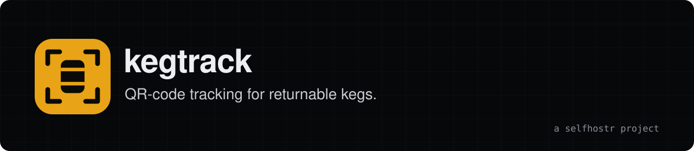

<div align="center">

<a href="https://kegtrack.selfhostr.io"></a>

<h3>A self-hosted, multi-tenant app to track returnable kegs with QR codes.</h3>

[](https://github.com/selfhostr/kegtrack/actions/workflows/integration.yml)
[](https://scorecard.dev/viewer/?uri=github.com/selfhostr/kegtrack)
[](LICENSE)

</div>

Screenshots: [screenshots/](screenshots/)

## Overview

- **Every keg has a QR label, every field operation is a scan.** At any moment you can answer: where is this keg and for how long, what is in it (beer, lot, tank), how many clean kegs are available, which ones have not come back after N days, and who received lot 2026-017.
- **The history is the source of truth.** Keg state is computed from an append-only stream of events. A brewery is the typical user, but nothing is specific to beer: any organisation that lends out deposit kegs can use it. The interface is in English and French.
- **Free, for good.** MIT licence, no paid edition.

## Quick start

Try the [live demo](https://kegtrack.selfhostr.io/demo/) first.

You need Docker with the `compose` plugin. No Rust, Node or PostgreSQL on the machine.

```bash
cp .env.exemple .env      # fill every password, see the installation guide
docker compose up -d --build
docker compose run --rm app provisionner-brasserie \
  --nom "Brasserie du Phare" --slug phare --prefixe-qr PHARE \
  --admin-email contact@brasserie.fr --admin-nom Martin --admin-prenom Claire
```

The last command prints the administrator password once. Open the app on port `6666` (or the domain you set in `DOMAINE_PUBLIC`), sign in, then set your PIN in *My account*.

> [!WARNING]
> **The camera requires HTTPS.** Browsers block it on plain `http://192.168.x.x`. Use a tunnel or a domain with a certificate: see [HTTPS and camera](docs/https-camera.md). A handheld scanner and manual entry work without it.

Back up the `sauvegardes` volume and your `.env`. Backups, restore and updates are in [Operations](docs/operations.md).

## Features

- **Scanner:** Bluetooth scanner (seen as a keyboard), rear camera with torch, or manual entry. Each read gives a full-screen colour, a sound and a vibration.
- **Batch operations** (washing, filling, delivery, customer return): configure once, scan dozens of kegs. An incompatible keg is rejected at scan time. The capture is stored server-side. Validation is transactional: everything passes, or nothing is written.
- **Delivery note** generated on validation, printable, with two signature fields.
- **Fleet:** full-text search, combinable filters, sorting, age in status, CSV and Excel export that reuses the active filters.
- **Keg page** with the next action, other allowed actions, full timeline and label reprint.
- **Customers** with the kegs they hold. A customer holding kegs cannot be archived, and a customer is never deleted.
- **Lots and product recall:** every customer concerned by a lot, with contacts, quantities and exact QR codes.
- **Dashboard and global search** (`/` key), depending on the role.
- **Administration:** beers, locations, tanks, users, QR label sheets (3 x 8, 70 x 37 mm), spreadsheet import, settings and a filterable audit log.
- **Roles:** Read, Production, Administrator within a brewery, plus a separate publisher back-office (`/editeur`).
- **Mobile first:** lists become cards below 720 px, touch targets are at least 44 px. Dark theme by default, light theme on request.

The full tour is in the [user guide](docs/user-guide.md).

## Architecture

Rust (Axum, SQLx) on PostgreSQL 17, server-rendered with Maud and htmx, three small JavaScript files, no SPA and no CDN. Four crates (`domaine`, `persistance`, `web`, `app`). Tenants are isolated by PostgreSQL Row Level Security, and the `evenement_fut` table is append-only. Details in [Architecture](docs/architecture.md).

## Limits

- **Out of scope for v1:** billing, deposits and amounts due, offline operation, a native app, self-service sign-up, a public API, custom statuses, multi-site.
- **One instance.** Rate limiting per IP lives in memory, so running several app instances needs one change first.
- **Paper labels do not survive** an 80 °C caustic wash. Plan for engraved plates or industrial polyester labels.
- **The project is written in French:** identifiers, code comments and commit messages. The documentation is in English and French.

## Status

Version 1.0.0 was released on 2026-10-17, and only the latest `main` is supported. The [changelog](CHANGELOG.md) lists every change.

## Contributing

Issues and pull requests are welcome. See [CONTRIBUTING.md](CONTRIBUTING.md) and the [development guide](docs/development.md). Report vulnerabilities privately, as described in [SECURITY.md](SECURITY.md).

## License

MIT, see [LICENSE](LICENSE). kegtrack is provided "as is", without warranty of any kind.

## Support kegtrack

kegtrack is free and has no company behind it. If it saves you time, you can support its development:

- **GitHub Sponsors** (recurring or one-off): [github.com/sponsors/selfhostr](https://github.com/sponsors/selfhostr)
