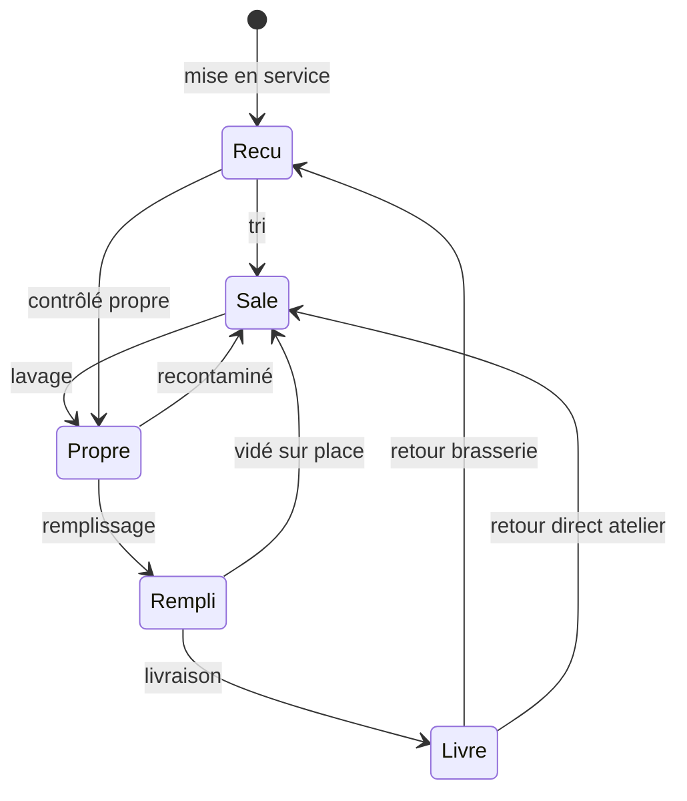

# Phase 0 — Architecture

**Projet** : traçabilité de fûts de bière par QR code (SaaS multi-locataire)
**Date** : 2026-09-18
**Statut** : proposition soumise à validation. Aucun code n'est écrit avant accord.

Ce document répond point par point au livrable attendu de la Phase 0 : modèle de
données complet avec `tenant_id` et politiques RLS, machine à états, structure du
flux d'événements et des projections, arborescence, dépendances justifiées,
stratégie de test, contenu du `docker compose`.

Il s'appuie sur quatre décisions prises en ouverture :

| Question | Décision |
|---|---|
| Rôle du statut « Reçu » | Retour brasserie **et** état initial à la mise en service |
| Langue des identifiants | Domaine en français, infrastructure en anglais |
| Gabarits | Maud |
| Déploiement v1 | SaaS mutualisé : une instance, un domaine, une base |

Aucune décision de la section A.2 de la spécification n'est contestée.

---

## 1. Vue d'ensemble

```
                          Internet
                             │ https://app.exemple.fr
                             ▼
                      ┌─────────────┐
                      │    Caddy    │  TLS automatique, en-têtes de sécurité
                      └──────┬──────┘
                             │ h2c interne
                             ▼
   ┌──────────────────────────────────────────────────────┐
   │                      webqr (Rust)                     │
   │                                                       │
   │   crate web        routes Axum, gabarits Maud, i18n   │
   │   crate domaine    statuts, transitions, projections  │
   │   crate persistance SQLx, migrations, garde RLS       │
   │   crate app        binaire : serve + commandes CLI    │
   └───────┬───────────────────────┬───────────────────────┘
           │ rôle webqr_app        │ rôle webqr_editeur
           │ (soumis à la RLS)     │ (back-office éditeur)
           ▼                       ▼
   ┌──────────────────────────────────────────────────────┐
   │                   PostgreSQL 17                       │
   │   RLS active sur chaque table métier                  │
   │   propriétaire des tables : webqr_owner (migrations)  │
   └──────────────────────────────────────────────────────┘
                             │
                      ┌──────┴──────┐
                      │  sauvegarde │  pg_dump -Fc, rotation
                      └─────────────┘
```

Le navigateur reçoit du HTML rendu par le serveur. htmx pilote les échanges
partiels des écrans de gestion. Une seule page embarque du JavaScript autonome :
le scan.

---

## 2. Arborescence du projet

```
webqr/
├── Cargo.toml                    # workspace
├── compose.yaml                  # production
├── compose.dev.yaml              # développement (HTTPS inclus)
├── .sqlx/                        # données de vérification hors-ligne des requêtes
│
├── crates/
│   ├── domaine/                  # cœur métier — aucune dépendance I/O
│   │   ├── statut.rs             # enum Statut, transitions, préconditions
│   │   ├── evenement.rs          # TypeEvenement, Origine, EvenementACreer
│   │   ├── projection.rs         # appliquer(EtatFut, &Evenement) -> EtatFut
│   │   ├── role.rs               # Role + capacités
│   │   ├── contenance.rs
│   │   ├── reference.rs          # format des références de document
│   │   └── erreur.rs             # ErreurMetier, messages français
│   │
│   ├── persistance/
│   │   ├── migrations/           # 0001_roles.sql, 0002_locataire.sql, …
│   │   ├── garde.rs              # TransactionLocataire — voir §5
│   │   ├── locataire.rs  utilisateur.rs  session.rs
│   │   ├── fut.rs  evenement.rs  document.rs
│   │   ├── client.rs  lot.rs  referentiel.rs
│   │   ├── audit.rs  compteur.rs
│   │   └── reconstruction.rs     # rejeu des événements
│   │
│   ├── web/
│   │   ├── routes/               # un module par domaine fonctionnel
│   │   │   └── table.rs          # table méthode+chemin -> rôle requis (§9)
│   │   ├── gabarits/             # fonctions Maud
│   │   │   ├── socle.rs  composants.rs  impression.rs
│   │   │   └── futs.rs  clients.rs  documents.rs  scan.rs  …
│   │   ├── middleware/           # session, locataire, csrf, audit, debit
│   │   ├── i18n/
│   │   │   ├── mod.rs            # macro t! vérifiée à la compilation
│   │   │   └── fr.rs             # catalogue unique
│   │   ├── formulaire.rs         # validation + erreurs par champ
│   │   └── erreur.rs             # ErreurWeb -> réponse HTML ou fragment htmx
│   │
│   └── app/                      # binaire
│       └── commandes/            # serve, provisionner, semer, reconstruire, …
│
├── assets/
│   ├── css/entree.css            # source Tailwind
│   ├── js/scan/                  # îlot TypeScript
│   │   ├── index.ts  douchette.ts  camera.ts
│   │   ├── decodeur.ts  retour.ts  file.ts  journal.ts
│   └── vendor/                   # htmx, zxing-wasm (aucun CDN)
│
├── statique/                     # sortie de build : app.css, scan.js, *.wasm
├── docker/
│   ├── Dockerfile  Caddyfile  Caddyfile.dev  sauvegarde.sh
└── docs/
    ├── PHASE-0-ARCHITECTURE.md   # ce document
    ├── installation.md  exploitation.md  guide-utilisateur.md
```

### Pourquoi un workspace en quatre crates

`domaine` ne déclare ni `sqlx`, ni `axum`, ni `tokio`. Le compilateur garantit
donc que la machine à états et les projections restent testables sans base, et
qu'aucune règle métier ne fuit dans un handler HTTP. `persistance` est séparé de
`web` pour que le test d'isolation multi-locataire attaque la couche données
directement, sans passer par HTTP.

---

## 3. Modèle de données

Conventions : identifiants `uuid` (v7 pour les événements, afin que l'ordre
d'insertion suive l'ordre temporel), horodatages `timestamptz`, énumérations
PostgreSQL natives en `snake_case` sans accent, noms de tables au singulier.

### 3.1 Tables hors locataire

**`locataire`** — la brasserie.

| colonne | type | note |
|---|---|---|
| `id` | uuid pk | |
| `nom` | text | |
| `identifiant_court` | citext unique | slug, utilisé dans les URL d'administration |
| `prefixe_qr` | text unique | **unique globalement** : deux brasseries ne peuvent pas émettre le même code |
| `emplacement_defaut_id` | uuid null | FK différée vers `emplacement` |
| `fuseau_horaire` | text | défaut `Europe/Paris` |
| `seuil_alerte_non_revenu_jours` | int | défaut 30 |
| `contenances_autorisees` | int[] | défaut `{20,30,50}` — voir écart 1 au §14 |
| `etat` | `locataire_etat` | `actif` \| `suspendu` |
| `cree_le`, `modifie_le` | timestamptz | |

**`super_admin`** — comptes éditeur. Table **distincte** de `utilisateur` : aucun
compte locataire ne peut être promu éditeur par une écriture malencontreuse.
Colonnes : `id`, `email` citext unique, `mot_de_passe_hash`, `nom`, `actif`,
`cree_le`.

**`session_super_admin`** — même structure que `session`, sans `tenant_id`.

**`journal_audit_editeur`** — `id`, `super_admin_id`, `action`, `locataire_id`
null, `details` jsonb, `ip`, `survenu_le`. Toute usurpation de support y écrit
une entrée d'ouverture et une de fermeture, et la session usurpée porte un
bandeau permanent côté interface.

### 3.2 Tables locataires

Toutes portent `tenant_id uuid not null references locataire(id)` et sont
soumises à la RLS.

**`utilisateur`** — `email` citext, `mot_de_passe_hash`, `pin_hash` null, `nom`,
`prenom`, `role` (`administrateur` \| `production` \| `lecture`), `actif`,
`derniere_connexion_le`, `echecs_connexion`, `verrouille_jusqu_a`.
Unique `(tenant_id, email)`.

**`session`** — `utilisateur_id`, `jeton_hash` bytea unique, `appareil_libelle`,
`ip_creation` inet, `cree_le`, `expire_le`, `derniere_activite_le`,
`verrouillee` bool, `echecs_pin` int, `pin_bloque_jusqu_a`, `revoquee_le`,
`jeton_csrf`.

**`type_biere`** — `nom`, `couleur` (hex), `actif`, `ordre`.
Unique `(tenant_id, lower(nom))`.

**`emplacement`** — `nom`, `actif`. Unique `(tenant_id, lower(nom))`.

**`cuve`** — `nom`, `actif`. Unique `(tenant_id, lower(nom))`.

**`client`** — `societe`, `contact_nom`, `contact_prenom`, `telephone`, `email`,
`archive` bool, métadonnées.

**`adresse_client`** — `client_id`, `libelle`, `rue`, `code_postal`, `ville`,
`archive`.
Contrainte clé : `unique (tenant_id, client_id, id)`. Elle permet aux tables
qui référencent un couple client+adresse de poser une **clé étrangère composite**
`(tenant_id, client_id, adresse_client_id)`. La cohérence « l'adresse appartient
bien au client » devient alors structurellement impossible à violer, y compris
par une requête forgée à la main. La validation applicative reste présente pour
produire un message clair, mais elle n'est plus la seule barrière.

**`lot`** — `numero`, `date_brassage` date, `type_biere_id`, `cuve_id`, `dluo`
date, `commentaire`. Unique `(tenant_id, numero)`.

**`fut`** — identité et projection réunies sur une ligne.

| groupe | colonnes |
|---|---|
| identité | `code_qr` (unique `(tenant_id, code_qr)`), `contenance_litres` int, `date_mise_en_service` date, `commentaire` |
| projection | `statut`, `emplacement_id`, `client_id`, `adresse_client_id`, `type_biere_id`, `lot_id`, `cuve_id`, `date_remplissage`, `statut_depuis_le`, `dernier_lavage_le`, `dernier_lavage_par` |
| traçage | `dernier_evenement_id`, `dernier_evenement_le`, `sequence_courante` bigint |
| recherche | `recherche_txt` text — concaténation code QR + lot + société cliente, tenue à jour par la projection, indexée en GIN trigramme |
| métadonnées | `cree_le`, `cree_par`, `modifie_le`, `modifie_par` |

**`evenement_fut`** — la source de vérité, en ajout seul.

| colonne | note |
|---|---|
| `id` | uuid v7 |
| `tenant_id`, `fut_id` | |
| `sequence` | bigint, unique `(tenant_id, fut_id, sequence)` — ordre et contrôle de concurrence |
| `type_evenement` | `mise_en_service` \| `transition` \| `transition_forcee` \| `correction` \| `modification_donnees` \| `import` |
| `origine` | `scan` \| `document` \| `edition_manuelle` \| `import` \| `systeme` |
| `statut_avant`, `statut_apres` | `statut_fut` null / not null |
| `emplacement_id`, `client_id`, `adresse_client_id`, `type_biere_id`, `lot_id`, `cuve_id` | valeurs portées par l'événement |
| `commentaire`, `justification` | `justification` obligatoire si `transition_forcee` |
| `document_id` | null hors document de mouvement |
| `utilisateur_id`, `survenu_le`, `enregistre_le` | |

Immuabilité garantie à deux niveaux : `REVOKE UPDATE, DELETE` pour le rôle
applicatif, **et** un trigger `BEFORE UPDATE OR DELETE` qui lève une exception
quel que soit le rôle. Une erreur se corrige par un événement de type
`correction`, jamais par une réécriture.

**`document_mouvement`** — `type` (`livraison` \| `retour` \| `operation_interne`),
`reference` (unique `(tenant_id, reference)`), `etat` (`brouillon` \| `valide` \|
`abandonne`), la configuration à appliquer (`statut_cible`, `type_biere_id`,
`lot_id`, `cuve_id`, `emplacement_id`, `client_id`, `adresse_client_id`,
`commentaire`), `cree_par`, `cree_le`, `valide_par`, `valide_le`.

**`ligne_document`** — `document_id`, `fut_id`, `statut_avant_capture`,
`capture_le`, `capture_par`, `evenement_id` null, `ordre`.
Unique `(tenant_id, document_id, fut_id)` : le dédoublonnage est garanti par la
base, pas seulement par l'interface.

**`journal_audit`** — `utilisateur_id`, `action`, `cible_type`, `cible_id`,
`details` jsonb, `ip`, `survenu_le`.

**`compteur_reference`** — `(tenant_id, cle)` pk, `valeur` bigint. Numérotation
des documents par verrou de ligne, sans trou visible et sans séquence globale
partagée entre locataires.

### 3.3 Index

- `fut (tenant_id, statut)`, `fut (tenant_id, client_id)`, `fut (tenant_id, lot_id)`
- `fut (tenant_id, dernier_evenement_le desc)`, `fut (tenant_id, statut_depuis_le)`
- `fut` GIN trigramme sur `recherche_txt`
- `evenement_fut (tenant_id, fut_id, sequence)`, `(tenant_id, lot_id)`, `(tenant_id, survenu_le desc)`
- `ligne_document (tenant_id, document_id)`
- `session (jeton_hash)`

Toutes les listes sont paginées côté serveur par curseur (clé composite
`(tri, id)`), pas par `OFFSET` : le coût reste constant quelle que soit la page.

---

## 4. Machine à états

### 4.1 Type fermé

```rust
#[derive(Copy, Clone, PartialEq, Eq, Hash, sqlx::Type)]
#[sqlx(type_name = "statut_fut", rename_all = "snake_case")]
pub enum Statut { Recu, Sale, Propre, Rempli, Livre, HorsService, Perdu }
```

Côté base, un type énuméré natif `statut_fut` aux valeurs sans accent
(`recu`, `sale`, `propre`, `rempli`, `livre`, `hors_service`, `perdu`).
L'accent n'existe que dans le catalogue de traduction. La classe de bugs de
l'ancienne version disparaît par construction.

### 4.2 Transitions



Table complète, `Hors service` et `Perdu` inclus :

| Depuis | Vers autorisés |
|---|---|
| *(création)* | `Recu` — ou n'importe quel statut par import de reprise |
| `Recu` | `Sale`, `Propre`, `HorsService`, `Perdu` |
| `Sale` | `Propre`, `HorsService`, `Perdu` |
| `Propre` | `Rempli`, `Sale`, `HorsService`, `Perdu` |
| `Rempli` | `Livre`, `Sale`, `HorsService`, `Perdu` |
| `Livre` | `Recu`, `Sale`, `HorsService`, `Perdu` |
| `HorsService` | `Sale`, `Propre`, `Perdu` |
| `Perdu` | `Recu`, `Sale`, `HorsService` |

`Perdu` et `HorsService` sont réversibles : un fût se retrouve, un fût se répare.
Aucun statut n'est un puits.

### 4.3 Préconditions

| Transition | Exigences |
|---|---|
| → `Rempli` | type de bière, lot et cuve fournis ; le type de bière du lot doit correspondre ; lot appartenant au locataire |
| → `Livre` | client **et** adresse fournis ; adresse appartenant au client (garanti par clé étrangère composite) ; client non archivé |
| → `Perdu` | justification non vide |
| → `HorsService` | justification non vide |
| forcée | rôle `Administrateur` **et** justification non vide |

### 4.4 Effets sur la projection

| Statut atteint | Effet |
|---|---|
| `Recu` | client et adresse remis à null ; emplacement = celui de l'événement ou emplacement par défaut. **Le contenu est conservé** : un fût peut revenir plein. |
| `Sale` | bière, lot, cuve, date de remplissage et client remis à null |
| `Propre` | enregistre `dernier_lavage_le` et `dernier_lavage_par` (traçabilité sanitaire, A.4.8) |
| `Rempli` | bière, lot, cuve posés ; `date_remplissage` = date de l'événement |
| `Livre` | client et adresse posés ; emplacement remis à null — le fût n'est plus dans la brasserie |
| `HorsService`, `Perdu` | contenu et client conservés : l'histoire reste lisible |

### 4.5 Transition forcée

Le graphe ci-dessus refuse par exemple `Propre → Livre` (livrer un fût vide à un
client en échange). C'est un cas réel mais marginal : il passe par la transition
forcée, réservée aux administrateurs, avec justification obligatoire, et produit
un événement `transition_forcee` visible comme tel dans la chronologie. C'est
exactement le rôle que la spécification lui donne — la réalité de l'atelier
dépasse le modèle, mais elle laisse une trace.

---

## 5. Isolation multi-locataire

### 5.1 Trois rôles PostgreSQL

| Rôle | Usage | RLS |
|---|---|---|
| `webqr_owner` | propriétaire des tables, joue les migrations au démarrage puis n'est plus utilisé | contourne (propriétaire) |
| `webqr_app` | **toutes** les requêtes des locataires | **soumis** |
| `webqr_editeur` | back-office éditeur uniquement | politique dédiée `USING (true)` |

Aucun de ces rôles n'est superutilisateur et aucun ne porte `BYPASSRLS`. Le point
décisif : `webqr_app` **n'est pas propriétaire des tables**, sans quoi PostgreSQL
lui ferait contourner les politiques silencieusement. C'est l'erreur classique
d'implémentation de la RLS, et la raison pour laquelle le test du §11.1 est écrit
en premier.

Trois pools distincts dans l'application ; celui de `webqr_owner` est fermé une
fois les migrations jouées.

### 5.2 Politique

Appliquée à l'identique sur chaque table métier :

```sql
alter table fut enable row level security;

create policy isolation_locataire on fut
  for all to webqr_app
  using      (tenant_id = nullif(current_setting('app.locataire_id', true), '')::uuid)
  with check (tenant_id = nullif(current_setting('app.locataire_id', true), '')::uuid);

create policy acces_editeur on fut for all to webqr_editeur using (true);
```

Si le paramètre n'est pas positionné, `current_setting(…, true)` renvoie `NULL`,
la comparaison vaut `NULL`, et **aucune ligne ne remonte**. L'échec est fermé par
défaut, pas ouvert.

### 5.3 La garde applicative

Chaque requête HTTP ouvre une transaction et y positionne le locataire :

```rust
// crates/persistance/src/garde.rs
pub struct TransactionLocataire<'t>(Transaction<'t, Postgres>);

impl<'t> TransactionLocataire<'t> {
    pub async fn ouvrir(pool: &PgPool, locataire: Uuid, utilisateur: Uuid)
        -> Result<Self, Erreur>
    {
        let mut tx = pool.begin().await?;
        sqlx::query!("select set_config('app.locataire_id', $1, true)",
                     locataire.to_string()).execute(&mut *tx).await?;
        sqlx::query!("select set_config('app.utilisateur_id', $1, true)",
                     utilisateur.to_string()).execute(&mut *tx).await?;
        Ok(Self(tx))
    }
    pub fn conn(&mut self) -> &mut PgConnection { &mut self.0 }
    pub async fn valider(self) -> Result<(), Erreur> { Ok(self.0.commit().await?) }
}
```

Le champ interne est privé et aucun autre constructeur n'existe. **Il n'est pas
possible d'obtenir une connexion applicative sans avoir déclaré le locataire.**
`set_config(…, true)` équivaut à `SET LOCAL` : la valeur est annulée à la fin de
la transaction, donc rien ne fuit vers la requête suivante qui réutilisera la
même connexion du pool.

Défense en profondeur telle qu'exigée : la colonne `tenant_id` est présente et
utilisée dans les requêtes **et** la politique la fait respecter. Un `WHERE`
oublié ne donne rien au lieu de tout donner.

---

## 6. Événements et projections

### 6.1 Écriture

Toute modification d'un fût suit la même séquence, dans **une seule** transaction :

```
1. select … from fut where id = $1 for update        -- sérialise les concurrents
2. domaine::statut::verifier(avant, apres, contexte) -- transition + préconditions
3. insert into evenement_fut (…, sequence = fut.sequence_courante + 1)
4. update fut set <projection = domaine::projection::appliquer(etat, evenement)>,
                  sequence_courante = …, dernier_evenement_id = …
5. commit
```

Le verrou `FOR UPDATE` sur la ligne du fût sérialise deux opérateurs qui
scanneraient le même fût en même temps : le second voit l'état réel produit par
le premier, et sa transition est réévaluée. L'unicité de `(fut_id, sequence)`
sert de filet en cas d'erreur de programmation.

La fonction de projection vit dans `domaine` et a la signature d'un pli :

```rust
pub fn appliquer(etat: EtatFut, e: &Evenement) -> EtatFut
```

Pure, sans I/O, donc testable exhaustivement et utilisable telle quelle par la
reconstruction.

### 6.2 Reconstruction

```
webqr reconstruire-projections [--locataire <slug>] [--verifier]
```

Rejoue `evenement_fut` ordonné par `(fut_id, sequence)` en repartant de l'état
initial, et réécrit les projections. Avec `--verifier`, calcule dans une table
temporaire et produit un diff sans rien écrire, en sortant avec un code non nul
s'il existe un écart. Cette variante tourne en intégration continue sur le jeu de
démonstration : c'est le test de cohérence décrit en A.4.1.

### 6.3 Ce que le flux rend gratuit

« Où était ce fût le 12 mars » est une lecture de `evenement_fut` filtrée par
date. La durée de rotation est une différence entre événements successifs. Le
temps passé chez un client est la somme des intervalles `Livre → Recu`. Les fûts
immobilisés sont un filtre sur `statut_depuis_le`. Le rappel produit est une
jointure `evenement_fut × lot × client`. Aucune de ces fonctions ne demande de
table supplémentaire.

---

## 7. Documents de mouvement

### 7.1 Cycle

```
   Configuration            Capture en rafale             Validation
  (statut cible,      →   POST /documents/:id/lignes  →  une transaction,
   bière, lot, cuve,       une ligne par scan,            tout ou rien
   client, adresse,        persistée immédiatement
   commentaire)            côté serveur
```

Le brouillon vit en base dès l'étape 1. Rafraîchissement, veille du téléphone,
batterie à plat, changement d'appareil : la capture est reprise telle quelle.
C'est ce qui rend la couche hors-ligne inutile (A.7).

### 7.2 Capture

`POST /documents-mouvement/:id/lignes` reçoit `{ code_qr }` et renvoie un
fragment htmx : la nouvelle ligne, le compteur mis à jour, et un en-tête
`HX-Trigger` que l'îlot de scan traduit en retour sonore et haptique.

Quatre issues, toutes traitées à la capture :

| Cas | Réponse |
|---|---|
| Fût trouvé, transition possible | ligne ajoutée, retour vert |
| Fût déjà présent dans le brouillon | avertissement, aucune ligne créée (unicité en base) |
| Code QR inconnu | erreur rouge nommée, aucune ligne, le scan continue |
| **Transition impossible** | refus immédiat avec la raison (« fût Sale, ne peut pas partir en livraison ») |

Le refus anticipé est le point important : l'opérateur l'apprend pendant qu'il a
le fût en main, pas dix minutes plus tard devant l'écran de validation.

### 7.3 Validation

Une transaction unique :

1. `select … from fut where id = any($1) order by id for update` — l'ordre par
   identifiant évite les interblocages entre deux validations concurrentes ;
2. réévaluation de **chaque** transition, car l'état a pu changer depuis la
   capture ;
3. un `evenement_fut` par ligne, mise à jour des projections, `ligne_document.evenement_id` renseigné ;
4. passage du document à `valide` ;
5. en cas d'échec sur une seule ligne : `rollback` complet, rapport détaillé
   ligne par ligne. **Rien n'est écrit.**

Références : `LIV-2026-0001`, `RET-2026-0001`, `INT-2026-0001`, allouées par
verrou de ligne sur `compteur_reference`, remises à zéro chaque année, par
locataire.

Le bon de livraison est une page HTML servie sur
`GET /documents-mouvement/:id/bon-de-livraison`, avec une feuille de style
`@media print` soignée et un emplacement de signature. Pas de dépendance PDF en
v1.

---

## 8. Authentification

| Élément | Choix |
|---|---|
| Mot de passe | Argon2id, `m = 19 456 Kio`, `t = 2`, `p = 1` (recommandation OWASP), sel par entrée |
| Cookie de session | `wq_session`, 32 octets aléatoires, **stocké haché** (SHA-256) en base ; `HttpOnly`, `Secure`, `SameSite=Lax`, `Max-Age` 30 jours |
| Verrouillage | inactivité configurable (défaut 15 min) → `session.verrouillee = true`, redirection vers l'écran de code PIN |
| Code PIN | 6 chiffres, Argon2id, **déverrouille seulement** une session valide ; 5 échecs → session révoquée, retour au mot de passe |
| Définition du PIN | depuis la fiche de l'utilisateur, confirmation par mot de passe courant |
| Limitation de débit | par IP sur `/connexion` et `/verrouillage` (fenêtre glissante en mémoire) **et** par compte en base (`echecs_connexion`, `verrouille_jusqu_a`) — la seconde survit à un redémarrage |
| CSRF | jeton par session stocké en base, champ caché dans chaque formulaire et en-tête htmx global ; vérification de `Origin` / `Sec-Fetch-Site` en complément |
| Méthodes | aucune action modifiante en `GET`. `POST` / `PUT` / `DELETE` exclusivement |

Le PIN ne crée jamais de session : il en réveille une déjà authentifiée sur un
appareil déjà connu. C'est la propriété qui rend le compromis acceptable pour un
atelier.

---

## 9. Autorisation

Trois rôles fixes, appliqués **côté serveur sur chaque route**.

| Rôle | Portée |
|---|---|
| `Administrateur` | tout dans sa brasserie, y compris utilisateurs, paramètres et transitions forcées |
| `Production` | scan, documents de mouvement, modification de fûts, lecture clients et lots |
| `Lecture` | consultation et export, aucune écriture |

### Le routeur est construit à partir d'une table

```rust
// crates/web/src/routes/table.rs
pub const ROUTES: &[Route] = &[
    Route::get ("/futs",                    Role::Lecture,       futs::liste),
    Route::post("/futs/:id/transition",     Role::Production,    futs::transition),
    Route::post("/futs/:id/forcer",         Role::Administrateur, futs::forcer),
    Route::get ("/administration/utilisateurs", Role::Administrateur, admin::utilisateurs),
    // …
];
```

Le `Router` Axum est assemblé en itérant cette table, jamais à la main. Ajouter
une route sans déclarer son rôle ne compile pas, et le test du §11.4 itère la
même table pour vérifier chaque combinaison rôle × route. Masquer un bouton dans
le gabarit reste du confort, jamais une protection.

---

## 10. Interface

### 10.1 Rendu serveur

Maud produit le HTML depuis des fonctions Rust. Un fragment htmx est un appel de
fonction : il n'existe pas de fichier de gabarit à synchroniser, et `clippy` et
`rustfmt` s'appliquent au balisage comme au reste.

### 10.2 Traduction centralisée

Une seule couche, dès le départ, même si la seule langue livrée est le français :

```rust
// crates/web/src/i18n/fr.rs
pub const CATALOGUE: &[(&str, &str)] = &[
    ("fut.statut.rempli",        "Rempli"),
    ("fut.erreur.transition",    "Un fût {avant} ne peut pas passer à {apres}."),
    // …
];
```

La macro `t!("fut.statut.rempli")` résout la clé **à la compilation** contre ce
catalogue : une clé absente est une erreur de compilation, pas une chaîne vide
découverte en production. Aucune chaîne visible par l'utilisateur n'est écrite en
dur dans un gabarit. Ajouter une langue consiste à ajouter un fichier et un
sélecteur ; c'est mécanique.

### 10.3 Bureau et atelier

Ce ne sont pas deux largeurs d'écran, ce sont deux jeux de routes et de gabarits.
Le tableau de bord sert une vue de pilotage dense à un `Administrateur` ou
`Lecture` sur poste fixe, et un écran tactile centré sur le scan à un compte
`Production`. Aucune détection de largeur en JavaScript : le serveur sait qui
demande.

Les cibles tactiles de l'atelier font 56 px minimum, le contraste est élevé, et
chaque scan produit trois retours simultanés — couleur plein écran, son, et
vibration — parce que l'opérateur ne regarde pas l'écran en continu.

### 10.4 L'îlot de scan

TypeScript compilé par `esbuild` (binaire autonome épinglé, aucune chaîne Node),
un seul paquet, chargé uniquement sur les pages de scan.

| Module | Rôle |
|---|---|
| `douchette.ts` | champ invisible qui garde le focus ; une saisie est reconnue comme douchette si l'intervalle médian entre frappes est inférieur à 35 ms sur au moins 4 caractères et se termine par Entrée en moins de 500 ms |
| `camera.ts` | `getUserMedia` en `facingMode: environment`, bascule avant/arrière, torche si disponible |
| `decodeur.ts` | `BarcodeDetector` natif si `getSupportedFormats()` contient `qr_code`, sinon chargement paresseux de zxing-wasm ; bascule invisible pour l'utilisateur |
| `retour.ts` | flash pleine largeur, bips WebAudio, `navigator.vibrate` |
| `file.ts` | file d'envoi sérialisée : deux scans rapprochés ne se doublent pas |
| `journal.ts` | liste des derniers scans avec leur issue |

Le serveur reste seul détenteur de l'état. Le JavaScript capture et envoie ; il
ne décide de rien. C'est ce qui permet de ne pas construire de couche hors-ligne.

La douchette est active dès le premier écran de scan, avant même la caméra : à
quelques dizaines de lignes, c'est le meilleur rapport effort/valeur du projet,
et elle rend la caméra secondaire plutôt qu'indispensable.

---

## 11. Stratégie de test

Priorité stricte à ce qui coûte cher en cas de bug.

### 11.1 Isolation multi-locataire — écrit en premier, ne casse jamais

Le test **énumère les tables depuis `information_schema`** plutôt que depuis une
liste écrite à la main. Conséquence : une table ajoutée plus tard sans politique
RLS fait échouer le test automatiquement, sans que personne n'ait pensé à le
mettre à jour.

Pour chaque table métier, avec deux locataires peuplés :

1. transaction avec `app.locataire_id = A`, `SELECT *` **sans aucun `WHERE`** →
   seules les lignes de A remontent ;
2. transaction **sans** paramètre positionné → zéro ligne ;
3. `INSERT` d'une ligne portant `tenant_id = B` alors que le paramètre vaut A →
   rejeté par `WITH CHECK` ;
4. `UPDATE … SET tenant_id = B` → rejeté.

### 11.2 Machine à états

Les 49 couples `(depuis, vers)` testés exhaustivement contre la table du §4.2,
plus les préconditions, plus du test basé sur les propriétés (`proptest`) :
pour toute séquence aléatoire d'événements valides, l'état final est atteignable
et la reconstruction redonne le même résultat que l'application incrémentale.

### 11.3 Document de mouvement

Atomicité : sur 30 lignes, une transition rendue impossible juste avant la
validation ⇒ zéro événement écrit, document toujours en brouillon, rapport
nommant la ligne fautive. Dédoublonnage. Refus anticipé à la capture. Reprise du
brouillon après redémarrage du processus.

### 11.4 Contrôle d'accès

Itération sur `routes::table::ROUTES` × les trois rôles : chaque combinaison
attend 200 ou 403, jamais autre chose. Une route non couverte fait échouer le
test.

### 11.5 Cohérence client / adresse

Requête forgée à la main portant l'adresse d'un autre client : rejetée. Vérifié
à deux niveaux — message applicatif clair, et clé étrangère composite qui rend
l'écriture impossible même si la validation était contournée.

### 11.6 Reconstruction des projections

Sur le jeu de démonstration complet : `reconstruire-projections --verifier` ne
produit aucun écart.

### 11.7 Outillage

`sqlx::test` fournit une base neuve par test. Les tests d'intégration démarrent
l'application sur un port éphémère et l'attaquent en HTTP réel. Les trois rôles
PostgreSQL sont créés par la migration `0001`, donc le test d'isolation s'exécute
dans les mêmes conditions que la production.

### 11.8 Intégration continue

`cargo fmt --check` · `cargo clippy -- -D warnings` · `cargo sqlx prepare --check`
· `cargo test` · `cargo deny check` · `cargo audit` · build Tailwind et esbuild ·
build de l'image Docker · **exercice de restauration** : la dernière sauvegarde
est restaurée dans une base jetable et un contrôle de cohérence est exécuté.

---

## 12. Dépendances

| Crate | Usage | Justification |
|---|---|---|
| `axum` 0.8 | serveur HTTP | décision arrêtée |
| `tokio` 1 | exécution asynchrone | requis par Axum |
| `tower`, `tower-http` | intergiciels | trace, compression, délai, identifiant de requête, en-têtes de sécurité |
| `sqlx` 0.8 | PostgreSQL | décision arrêtée ; requêtes vérifiées à la compilation, migrations intégrées |
| `maud` 0.27 | gabarits | décision validée en ouverture |
| `serde`, `serde_json` | formulaires, jsonb | standard |
| `uuid` (v4 + v7) | identifiants | v7 pour les événements : ordre d'insertion = ordre temporel |
| `chrono`, `chrono-tz` | dates et fuseaux | chaque locataire a son fuseau ; DLUO et seuils s'y calculent |
| `argon2` | hachage | exigé par A.8 |
| `rand` | jetons de session et CSRF | générateur cryptographique |
| `sha2` | empreinte des jetons de session | un vol de base ne donne pas les sessions |
| `clap` | commandes d'exploitation | provisionnement, semis, reconstruction, restauration |
| `csv` | export | sans dépendance lourde |
| `rust_xlsxwriter` | export Excel | Rust pur, aucune dépendance système |
| `calamine` | import de reprise | lit xlsx et xls |
| `qrcode` | planches d'étiquettes | génère du SVG inséré directement dans la page d'impression |
| `tracing`, `tracing-subscriber` | journalisation structurée | A.8 |
| `metrics-exporter-prometheus` | métriques | A.8 |
| `tower_governor` | limitation de débit par IP | complété par le comptage en base, par compte |
| `thiserror` | types d'erreur | |
| `proptest` (dev) | test basé sur les propriétés | machine à états, §11.2 |
| `reqwest` (dev) | tests d'intégration HTTP | |

Hors Rust, épinglés par version et somme de contrôle, téléchargés dans l'étape de
construction Docker : le binaire autonome **Tailwind**, le binaire **esbuild**,
**htmx** 2.x et **zxing-wasm**, tous servis depuis notre domaine. Aucun CDN :
la politique de sécurité de contenu est stricte.

Pas de crate de validation généraliste : les messages doivent être en français,
par champ, et réinjectables dans un fragment htmx. Un accumulateur d'erreurs
maison dans `web/formulaire.rs` fait le travail en moins de code qu'il n'en
faudrait pour contraindre une bibliothèque.

Pas de `tower-sessions` : la session porte le verrouillage, le PIN, les compteurs
d'échec et le jeton CSRF, tous liés au schéma métier. Une table et cinquante
lignes sont plus lisibles qu'une implémentation de magasin personnalisé.

---

## 13. Déploiement

### 13.1 `compose.yaml` — production

```yaml
services:
  caddy:
    image: caddy:2-alpine
    ports: ["80:80", "443:443", "443:443/udp"]
    volumes:
      - ./docker/Caddyfile:/etc/caddy/Caddyfile:ro
      - caddy_data:/data          # certificats, à conserver
      - caddy_config:/config
    depends_on: [app]
    restart: unless-stopped

  app:
    build: .
    environment:
      DATABASE_URL_OWNER:    ${DATABASE_URL_OWNER:?variable obligatoire}
      DATABASE_URL_APP:      ${DATABASE_URL_APP:?variable obligatoire}
      DATABASE_URL_EDITEUR:  ${DATABASE_URL_EDITEUR:?variable obligatoire}
      SECRET_SESSION:        ${SECRET_SESSION:?variable obligatoire}
      DOMAINE_PUBLIC:        ${DOMAINE_PUBLIC:?variable obligatoire}
      FUSEAU_DEFAUT:         ${FUSEAU_DEFAUT:-Europe/Paris}
      RUST_LOG:              ${RUST_LOG:-info}
    depends_on:
      postgres: { condition: service_healthy }
    restart: unless-stopped

  postgres:
    image: postgres:17-alpine
    environment:
      POSTGRES_PASSWORD: ${POSTGRES_PASSWORD:?variable obligatoire}
      POSTGRES_DB: webqr
    volumes: [pg_data:/var/lib/postgresql/data]
    healthcheck:
      test: ["CMD-SHELL", "pg_isready -U postgres -d webqr"]
      interval: 5s
      retries: 20
    restart: unless-stopped

  sauvegarde:
    image: postgres:17-alpine
    volumes:
      - ./docker/sauvegarde.sh:/sauvegarde.sh:ro
      - sauvegardes:/sauvegardes
    environment:
      PGPASSWORD: ${POSTGRES_PASSWORD}
      RETENTION_QUOTIDIENNE: ${RETENTION_QUOTIDIENNE:-7}
      RETENTION_HEBDOMADAIRE: ${RETENTION_HEBDOMADAIRE:-4}
      RETENTION_MENSUELLE: ${RETENTION_MENSUELLE:-6}
    entrypoint: ["/bin/sh", "/sauvegarde.sh"]
    depends_on: [postgres]
    restart: unless-stopped

volumes: { pg_data: , caddy_data: , caddy_config: , sauvegardes: }
```

La syntaxe `${VAR:?message}` fait **échouer bruyamment** `docker compose up` si
une variable obligatoire manque, avant même que le conteneur ne démarre.
Symétriquement, `Config::depuis_env()` collecte **toutes** les variables
manquantes et les signale ensemble avant de sortir en code 1 — pas une par
redémarrage.

### 13.2 Migrations

Jouées au démarrage du conteneur applicatif, avec le rôle `webqr_owner`, avant
l'ouverture du port d'écoute. Un verrou consultatif PostgreSQL évite que deux
instances ne les jouent en même temps. Le pool `owner` est fermé ensuite : le
service tourne uniquement sous `webqr_app` et `webqr_editeur`.

### 13.3 Le blocage caméra — traité maintenant, pas le jour de la démo

`getUserMedia` exige un contexte sécurisé. Servir sur `http://192.168.1.x:8080`
bloque la caméra et le produit ne fonctionne plus. Trois situations, trois
réponses documentées :

| Situation | Réponse |
|---|---|
| Production, nom de domaine | Caddy obtient et renouvelle le certificat automatiquement. Rien à faire. |
| Développement, poste local | `compose.dev.yaml` sert `https://webqr.localhost` avec `tls internal`. `caddy trust` installe l'autorité locale. |
| **Test sur un vrai téléphone** | un tunnel — `tailscale funnel` ou `cloudflared tunnel` — donne une URL publique avec un certificat valide, sans ouvrir de port. C'est la voie recommandée, et la seule qui fonctionne aussi sur iOS sans manipuler de profil de configuration. `mkcert` reste documenté en repli pour Android. |

Le `compose.dev.yaml` sert en HTTPS dès le premier jour ; le mode HTTP n'existe
pas, pour qu'aucun développement ne se fasse dans des conditions que la
production ne reproduit pas.

### 13.4 Sauvegarde et restauration

`pg_dump -Fc` quotidien, rotation 7 quotidiennes / 4 hebdomadaires / 6
mensuelles, configurable. Restauration par `webqr restaurer --fichier <chemin>`,
documentée dans `docs/exploitation.md`, et **exercée en intégration continue** :
le travail échoue si la dernière sauvegarde ne se restaure pas. Une sauvegarde
jamais restaurée n'est pas une sauvegarde.

### 13.5 Commandes d'exploitation

```
webqr serve
webqr provisionner-brasserie --nom "…" --slug … --prefixe-qr … --admin-email …
webqr semer-demonstration [--futs 3000]
webqr reconstruire-projections [--locataire …] [--verifier]
webqr exporter-locataire --locataire … --sortie archive.zip   # sortie de données
webqr supprimer-locataire --locataire … --confirmer
webqr restaurer --fichier …
```

`provisionner-brasserie` impose un mot de passe fort, ou émet un lien
d'invitation à usage unique. **Aucun compte par défaut n'existe nulle part** —
ni dans une migration, ni dans une image, ni dans le dépôt.

L'export et la suppression d'un locataire sont prévus dès le modèle comme le
demande A.3, même si leur écran arrive plus tard.

---

## 14. Écarts proposés

Cinq points où je m'écarte de la lettre de la spécification, ou où je tranche une
zone qu'elle ne couvre pas. Chacun se renverse d'un mot.

1. **Contenance** — stockée en litres (`int`) avec une liste de valeurs
   autorisées par brasserie (défaut 20 / 30 / 50) plutôt qu'un type fermé à trois
   valeurs. Certaines brasseries utilisent du 15 ou du 25 L, et un type fermé
   imposerait une migration pour les accueillir.
2. **`Propre → Livre` refusé** dans le graphe validé. Livrer un fût vide passe
   donc par une transition forcée d'administrateur. C'est volontaire : l'exception
   laisse une trace explicite au lieu de se fondre dans le flux normal.
3. **Justification obligatoire** pour `Perdu` et `HorsService`. La spécification
   ne l'exige que pour les transitions forcées ; sortir un actif de 130 € du parc
   mérite le même traitement.
4. **Troisième état de document** : `abandonne`, en plus de `brouillon` et
   `valide`. Vider un brouillon ne l'efface pas, il le clôt — sinon la piste
   d'audit a un trou.
5. **Deux rôles PostgreSQL applicatifs** (`webqr_app`, `webqr_editeur`) plutôt
   qu'un seul portant `BYPASSRLS` pour le back-office. Le code du back-office ne
   peut pas se tromper de pool : il n'a accès qu'au sien.

## 15. Risque signalé

L'absence de fonctionnement hors-ligne (A.7) repose sur l'hypothèse que le réseau
est disponible partout où l'on scanne. Les chambres froides et les caves sont les
endroits où cette hypothèse tombe le plus souvent. Le brouillon serveur couvre la
perte de session, pas la perte de réseau pendant la capture.

Je construis conformément à la décision — elle est ferme et je ne la conteste
pas. Deux précautions gratuites la rendent réversible : l'îlot de scan sérialise
ses envois dans une file (`file.ts`), et l'API de capture est idempotente sur
`(document_id, code_qr)`. Le jour où le hors-ligne deviendrait nécessaire, il se
brancherait sur cette file sans toucher au serveur. À vérifier sur site avant la
première installation.

---

## 16. Réponse aux douze écueils de la version précédente

| # | Écueil | Réponse |
|---|---|---|
| 1 | Aucun historique | `evenement_fut` en ajout seul, source de vérité — §6 |
| 2 | Champs métier en texte libre | trois référentiels par locataire, listes déroulantes — §3.2 |
| 3 | Statuts en chaînes accentuées | type fermé Rust + énumération PostgreSQL sans accent — §4.1 |
| 4 | Parc chargé d'un bloc | pagination par curseur, index dédiés, recherche trigramme — §3.3 |
| 5 | Suppressions par `GET`, sans CSRF | méthodes non idempotentes, jeton par session, contrôle d'`Origin` — §8 |
| 6 | Secrets et comptes en dur | échec bruyant au démarrage, aucun compte par défaut — §13.1, §13.5 |
| 7 | Aucune validation serveur | validation systématique, préconditions, contraintes en base — §4.3, §11 |
| 8 | Incohérence client / adresse | clé étrangère composite : structurellement impossible — §3.2 |
| 9 | Capture de lot perdue | brouillon persisté côté serveur — §7 |
| 10 | Distinction desktop/mobile en JS | deux jeux de routes et de gabarits selon le rôle — §10.3 |
| 11 | Ni tests, ni migrations, ni déploiement | six familles de tests, migrations versionnées, compose complet — §11, §13 |
| 12 | Aucun export | CSV et Excel sur toute vue filtrée, export intégral du locataire — §12, §13.5 |

---

## 17. Ordre de travail proposé pour la Phase 1

1. Workspace, `compose.dev.yaml` en HTTPS, `Config::depuis_env()` avec échec
   bruyant.
2. Migration `0001` : les trois rôles PostgreSQL. `0002` : `locataire`,
   `utilisateur`, `session` avec RLS.
3. **Le test d'isolation du §11.1, avant tout écran.** Il doit passer sur un
   schéma quasi vide, puis ne plus jamais casser.
4. Authentification complète : mot de passe, session, PIN, limitation de débit,
   CSRF.
5. Table des routes et extracteur de rôle, avec le test §11.4.
6. Back-office éditeur minimal et `provisionner-brasserie`.
7. Jeu de démonstration.
8. Intégration continue complète.

**Fin de la Phase 0. Je m'arrête ici et j'attends validation.**
