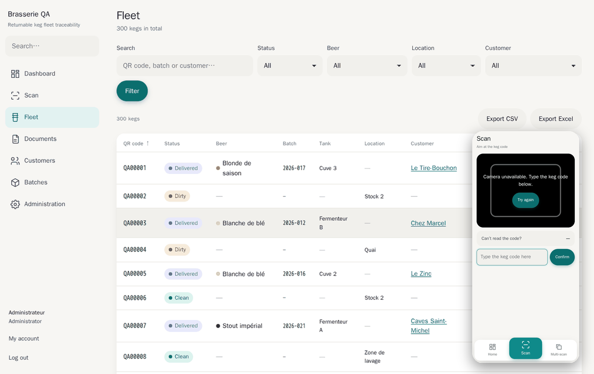

# kegtrack

À la fin de cette page, vous savez ce que fait kegtrack et où aller ensuite.

kegtrack suit des fûts consignés réutilisables par QR code. Chaque fût porte une étiquette et chaque opération de terrain est un scan. L'application est auto-hébergée, multi-locataire, et tourne en quatre services Docker. Une brasserie en est l'exemple typique, mais rien n'est propre à la bière.

À tout moment, elle répond à ces questions : où est ce fût et depuis combien de temps, que contient-il (bière, lot, cuve), combien de fûts propres sont disponibles, lesquels ne sont pas revenus après N jours, et qui a reçu le lot 2026-017. L'historique des opérations est la source de vérité, pas la fiche du fût.

## Pour commencer

- [Installer kegtrack](installation.fr.md) : secrets, démarrage, première brasserie.
- [Faire fonctionner la caméra](https-camera.fr.md) : les navigateurs bloquent la caméra sans HTTPS.
- [Utiliser l'application](user-guide.fr.md) : rôles, scan, opérations par lot, lots et rappel.
- [Comprendre comment c'est construit](architecture.fr.md) : crates, isolation, flux d'événements.

## Toutes les pages

| Section | Pages |
|---|---|
| Démarrer | [Installation](installation.fr.md), [HTTPS et caméra](https-camera.fr.md) |
| Utiliser | [Guide d'utilisation](user-guide.fr.md) |
| Référence | [Configuration](configuration.fr.md), [Architecture](architecture.fr.md) |
| Sécurité | [Sécurité](security.fr.md) |
| Exploitation | [Exploitation](operations.fr.md) |
| Développement | [Développement](development.fr.md) |

kegtrack est libre : licence MIT, pas d'édition payante. Sources et versions : [github.com/selfhostr/kegtrack](https://github.com/selfhostr/kegtrack).

!!! warning "Hors périmètre de la v1"
    Facturation, consignes et montants dus, fonctionnement hors ligne, application native, inscription libre, API publique, statuts personnalisés, multi-site.
